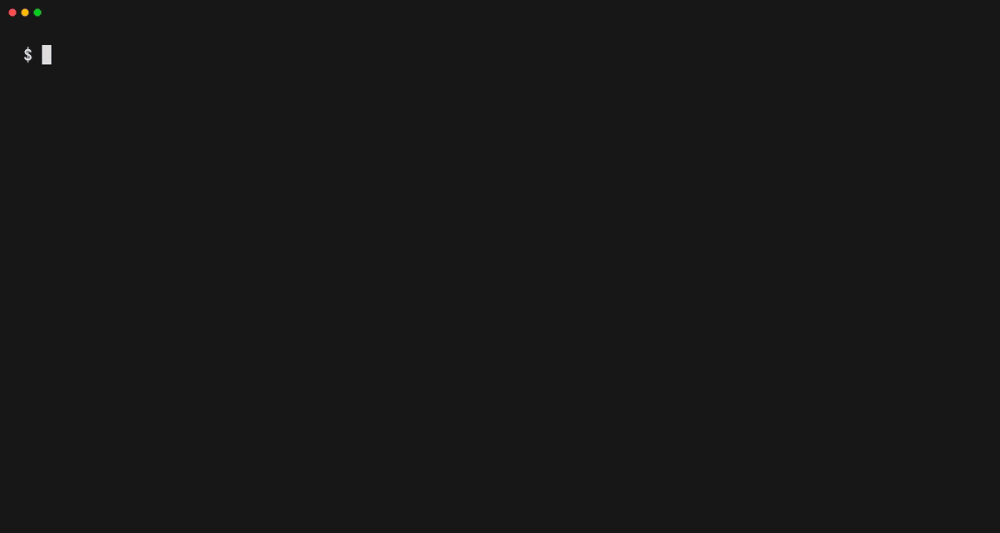

<p align="center">
  <a href="README.md">English</a> | <b>Português</b>
</p>

<p align="center">
  <picture>
    <source media="(prefers-color-scheme: dark)" srcset="docs/assets/logo-dark.png">
    
  </picture>
</p>

<h1 align="center">GoAnime</h1>

<p align="center">
  <a href="https://github.com/alvarorichard/GoAnime/actions/workflows/ci.yml"></a>
  <a href="https://github.com/alvarorichard/GoAnime/releases/latest"></a>
  <a href="https://pkg.go.dev/github.com/alvarorichard/Goanime/pkg/goanime"></a>
  <a href="https://aur.archlinux.org/packages/goanime"></a>
  <a href="LICENSE"></a>
</p>

O GoAnime é um aplicativo de terminal para buscar, assistir e baixar animes,
filmes e séries em português e inglês. Ele pesquisa em várias fontes ao mesmo
tempo, reproduz o episódio escolhido no [mpv](https://mpv.io/) e guarda o
ponto em que você parou.

<p align="center">
  
</p>

É um único binário para Linux, macOS e Windows, e só precisa do mpv para
assistir. O [FFmpeg](https://ffmpeg.org/) é opcional: os downloads o usam para
embutir legendas, e o upscaling de vídeos depende dele.

## Conteúdo

- [Recursos](#recursos)
- [Instalação](#instalação)
- [Uso](#uso)
- [Fontes](#fontes)
- [Configuração](#configuração)
- [Arquivos](#arquivos)
- [Solução de problemas](#solução-de-problemas)
- [Usando o GoAnime como biblioteca](#usando-o-goanime-como-biblioteca)
- [Contribuindo](#contribuindo)
- [Comunidade](#comunidade)
- [Agradecimentos](#agradecimentos)
- [Aviso legal](#aviso-legal)
- [Licença](#licença)

## Recursos

- Pesquisa em todas as fontes ativas em paralelo e passa para outra fonte
  quando uma falha.
- Animes legendados e dublados em português e inglês, além de filmes e séries
  em português.
- Reprodução com escolha de qualidade, ou download de um episódio, de um
  intervalo ou da série inteira.
- Downloads salvos com nomes compatíveis com o Plex (`Anime - S01E01.mp4`).
- Retoma a reprodução e lembra os episódios assistidos.
- Pula a abertura pelo menu do player, usando os tempos do AniSkip.
- Discord Rich Presence.
- Upscaling com Anime4K em tempo real enquanto você assiste, ou de arquivos de
  vídeo e imagem.
- Atualiza a si mesmo com `goanime --update`.

## Instalação

O GoAnime usa o [mpv](https://mpv.io/) para reproduzir vídeos. Instale o mpv
antes, a menos que use o instalador do Windows, que já o inclui.

Há binários prontos para todas as plataformas na
[página de releases](https://github.com/alvarorichard/GoAnime/releases/latest).

### Windows

Baixe e execute o `GoAnime-Installer-<versão>.exe` da
[última release](https://github.com/alvarorichard/GoAnime/releases/latest).
Ele instala o GoAnime e o mpv e adiciona os dois ao `PATH`.

Se preferir não usar o instalador, baixe o `goanime-windows-amd64.zip`,
extraia o `goanime-windows-amd64.exe`, renomeie para `goanime.exe` e coloque em
uma pasta do seu `PATH`. O arquivo não inclui o mpv:
[instale-o](https://mpv.io/installation/) separadamente. O GoAnime encontra o
`mpv.exe` no `PATH` ou na mesma pasta do `goanime.exe`.

### macOS

```bash
brew install mpv
curl -Lo goanime https://github.com/alvarorichard/GoAnime/releases/latest/download/goanime-darwin-universal
chmod +x goanime
sudo mv goanime /usr/local/bin/
```

O binário é universal e roda tanto em Macs com Apple Silicon quanto com Intel.
Se você baixar pelo navegador em vez do `curl`, o macOS coloca o arquivo em
quarentena e se recusa a executá-lo; para liberar, rode
`xattr -d com.apple.quarantine /usr/local/bin/goanime`.

### Arch Linux

O GoAnime está disponível no [AUR](https://aur.archlinux.org/packages/goanime):

```bash
yay -S goanime
```

### Debian, Ubuntu, Fedora e outras distribuições

Instale o mpv pelo gerenciador de pacotes (`sudo apt install mpv` ou
`sudo dnf install mpv`) e depois:

```bash
curl -LO https://github.com/alvarorichard/GoAnime/releases/latest/download/goanime-linux-amd64.tar.gz
tar -xzf goanime-linux-amd64.tar.gz
sudo install goanime-linux-amd64 /usr/local/bin/goanime
```

Em ARM64, troque `amd64` por `arm64`.

### A partir do código-fonte

Com Go 1.27 ou mais recente:

```bash
go install github.com/alvarorichard/Goanime/cmd/goanime@latest
```

O histórico de progresso usa SQLite e depende de CGO, então é preciso ter um
compilador C disponível na hora do build. Sem ele, o GoAnime compila e
funciona normalmente, mas não registra o progresso. Os binários das releases
já vêm com SQLite. Mais detalhes em
[docs/BUILD_OPTIONS.md](docs/BUILD_OPTIONS.md).

### Verificando o download

Toda release inclui o `checksums-sha256.txt`. Calcule o hash do arquivo que
você baixou e compare com a linha desse arquivo:

```bash
sha256sum goanime-linux-amd64.tar.gz   # Linux
shasum -a 256 goanime                  # macOS, a linha goanime-darwin-universal
Get-FileHash goanime-windows-amd64.zip # Windows, no PowerShell
```

### Atualizando

| Instalado com                  | Atualize com                                      |
| ------------------------------ | ------------------------------------------------- |
| Instalador do Windows          | O instalador da nova versão                       |
| Binário ou arquivo da release  | `goanime --update`                                |
| AUR                            | O seu AUR helper, por exemplo `yay -Syu`          |
| `go install`                   | O mesmo comando `go install`                      |

O `goanime --update` confere o download com o `checksums-sha256.txt` da
release e não instala nada se não bater. Ele substitui o executável no lugar,
então, se ele estiver em uma pasta onde você não pode escrever, como
`/usr/local/bin`, rode `sudo goanime --update`.

## Uso

Rode `goanime` sem argumentos para abrir a tela inicial de busca. Digite um
nome e tecle enter, ou tecle `↓` para escolher nas listas abaixo: Continuar
reabre um episódio de onde você parou (`enter` retoma, `r` recomeça, `e` lista
os episódios, `x` remove) e Recentes repete uma busca passada com a contagem
de resultados. `tab` alterna o escopo entre ALL, PT-BR, ENGLISH e MOVIES/TV.
No resultado, escolha a versão com `←` `→` e, se for uma série, um episódio.
Também dá para passar o nome direto:

```bash
goanime "one piece"
```

Use espaços no nome, não hífens.

Os downloads de anime vão para `~/.local/goanime/downloads/anime/`, a menos
que você use `-o`:

```bash
goanime -d "one piece" 1                  # episódio 1
goanime -d -r "naruto" 1-12               # episódios 1 a 12
goanime -d -a "one piece"                 # todos os episódios
goanime -d --quality 720p "frieren" 1     # uma qualidade específica
goanime -d -o ~/Anime "bleach" 10         # outra pasta
```

A pasta passada em `-o` precisa estar dentro da sua pasta pessoal.

Filmes e séries usam `-dm` e vão para `~/.local/goanime/downloads/movies/`:

```bash
goanime -dm "Interestelar"                # um filme
goanime -dm --type tv "Dark" 1 5          # temporada 1, episódio 5
goanime -dm -r "Dark" 1 1-5               # temporada 1, episódios 1 a 5
goanime -dm -a "Dark"                     # todas as temporadas
```

Alguns streams são baixados com o [yt-dlp](https://github.com/yt-dlp/yt-dlp),
que o GoAnime baixa sozinho na primeira vez que precisa dele.

Outras opções:

```bash
goanime --source animefire "jujutsu kaisen"   # buscar em uma única fonte
goanime --upscale --upscale-hq video.mp4      # upscale de um arquivo com Anime4K
goanime --update                              # atualizar para a última versão
goanime --debug "naruto"                      # gerar um log de depuração
```

Rode `goanime -h` para ver todas as opções.

### Teclas

| Tecla                 | Ação                      |
| --------------------- | ------------------------- |
| `↑` `↓` ou `k` `j`    | Mover                     |
| Digitar, ou `/`       | Filtrar a lista           |
| `g` `G`               | Primeiro ou último item   |
| `Enter`               | Selecionar                |
| `Esc`                 | Voltar                    |
| `tab`                 | Trocar o escopo da busca (tela inicial) |
| `←` `→`               | Escolher uma versão (resultados) |
| `r` `e` `x`           | Do início, episódios, remover (lista Continuar) |
| `d` `D` `A` `m`       | Baixar um, intervalo, todos, opções (episódios) |

Num menu que mostra uma letra ao lado de cada opção, essa letra escolhe a
opção na hora; qualquer outra tecla continua filtrando.

A lista de episódios marca com ✓ os episódios que você terminou e com ◐ o que
você parou no meio, e abre onde você parou.

### Durante a reprodução

Enquanto o mpv reproduz, o terminal mostra o menu do player, com o quanto do
episódio já passou:

| Tecla | Opção                            | O que faz                                              |
| ----- | -------------------------------- | ------------------------------------------------------ |
| `n`   | Next episode                     | Reproduz o próximo episódio                            |
| `p`   | Previous episode                 | Reproduz o episódio anterior                           |
| `e`   | Select episode                   | Escolhe outro episódio da lista                        |
| `c`   | Change anime                     | Busca outro título                                     |
| `s`   | Skip intro                       | Pula a abertura, quando o AniSkip tem os tempos dela   |
| `a`   | Audio track                      | Troca a faixa de áudio, quando há mais de uma          |
| `t`   | Subtitles                        | Troca ou desliga as legendas, quando há alguma         |
| `Esc` | ← Back                           | Volta ao menu de download e reprodução                 |
| `q`   | Exit                             | Fecha o mpv e sai                                      |

Em filmes, o menu oferece Replay movie (`r`), Change movie (`c`), as opções de
faixa, ← Back e Exit. Quando um episódio ou filme tem progresso salvo, o
GoAnime pergunta se você quer continuar de onde parou.

### Upscaling em tempo real

A opção Real-time Upscale, no menu antes da reprodução, aplica os shaders do
[Anime4K](https://github.com/bloc97/Anime4K) no mpv. Na primeira vez, escolha
Setup shaders para baixá-los e depois escolha um modo. O nome de cada modo diz
para que ele serve, de Performance, para GPUs fracas, a Ultra, para fontes em
SD.

## Fontes

| Fonte         | Conteúdo       | Idioma                      | Observações                                   |
| ------------- | -------------- | --------------------------- | --------------------------------------------- |
| HiAnime       | Animes         | Inglês, legendado e dublado | Legendado por padrão                          |
| AnimeFire     | Animes         | Português (Brasil)          |                                               |
| AnimesDigital | Animes         | Português (Brasil)          | Legendado e dublado                           |
| Goyabu        | Animes         | Português (Brasil)          | Desativada por padrão, veja abaixo            |
| StartFlix     | Filmes, séries | Português (Brasil)          | Dublado e legendado                           |
| TopCine       | Filmes, séries | Português (Brasil)          | Apenas catálogo; a reprodução usa o StartFlix |

`--source` limita a busca a uma fonte: `hianime`, `animefire`, `animesdigital`,
`startflix` ou `topcine`, ou `ptbr` para todas as fontes em português.

O Goyabu fica atrás de uma verificação do Cloudflare e vem desativado. Ele
ainda funciona em redes que o Cloudflare não verifica; para ativá-lo, use
`GOANIME_ENABLED_SOURCES=goyabu`.

O GoAnime depende de sites de terceiros, e esses sites mudam sem aviso. Quando
isso acontece, a fonte correspondente pode parar de funcionar até ser
atualizada. Um [workflow agendado](.github/workflows/source-health.yml) testa
todas as fontes diariamente, então a falha costuma aparecer lá antes de ser
reportada.

## Configuração

O GoAnime não precisa de arquivo de configuração. Algumas variáveis de
ambiente cobrem casos menos comuns:

| Variável                      | Descrição                                                                |
| ----------------------------- | ------------------------------------------------------------------------ |
| `GOANIME_ENABLED_SOURCES`     | Fontes a ativar, separadas por vírgula, como `goyabu`                    |
| `GOANIME_DISABLED_SOURCES`    | Fontes a ignorar, separadas por vírgula                                  |
| `GOANIME_THEME`               | `dark`, `light` ou `auto` (padrão): `auto` pergunta o fundo ao terminal uma vez |
| `GOANIME_PLAIN`               | `1` para o modo simples: sem cores, sem glosas em japonês, só ASCII (igual a `--plain`, `NO_COLOR` ou `TERM=dumb`) |
| `GOANIME_HIANIME_AUDIO`       | `sub` (padrão) ou `dub`                                                  |
| `GOANIME_STRICT_SOURCE`       | `1` para mostrar um erro em vez de adivinhar uma fonte desconhecida      |
| `GOANIME_ANIMEFIRE_API`       | Endereço da API do AnimeFire                                             |
| `GOANIME_STARTFLIX_URL`       | Endereço do StartFlix                                                    |
| `GOANIME_STARTFLIX_PANEL_URL` | Endereço do painel de vídeo do StartFlix                                 |
| `GOANIME_TOPCINE_URL`         | Endereço do TopCine                                                      |
| `TMDB_API_KEY`                | Uma chave do [TMDB](https://www.themoviedb.org/settings/api) para detalhes de filmes, séries e temporadas |
| `OMDB_API_KEY`                | Uma chave do [OMDb](https://www.omdbapi.com/apikey.aspx) para usar no lugar da chave de demonstração compartilhada |

As variáveis de endereço apontam uma fonte para um novo domínio quando o site
muda, sem esperar uma nova versão.

## Arquivos

| O quê                   | Linux                                   | macOS                                                     | Windows                                       |
| ----------------------- | --------------------------------------- | --------------------------------------------------------- | --------------------------------------------- |
| Histórico               | `~/.local/goanime/tracking/progress.db` | `~/.local/goanime/tracking/progress.db`                   | `%LOCALAPPDATA%\GoAnime\tracking\progress.db` |
| Downloads               | `~/.local/goanime/downloads/`           | `~/.local/goanime/downloads/`                             | `%USERPROFILE%\.local\goanime\downloads\`     |
| Logs de depuração       | `~/.local/share/goanime/logs/`          | `~/Library/Logs/GoAnime/`                                 | `%LOCALAPPDATA%\GoAnime\logs\`                 |
| Shaders do Anime4K      | `~/.config/goanime/anime4k-shaders/`    | `~/Library/Application Support/goanime/anime4k-shaders/`  | `%APPDATA%\goanime\anime4k-shaders\`           |
| yt-dlp                  | `~/.cache/go-ytdlp/`                    | `~/Library/Caches/go-ytdlp/`                              | `%LOCALAPPDATA%\go-ytdlp\`                      |

No Linux, as pastas dos shaders e do yt-dlp seguem `XDG_CONFIG_HOME` e
`XDG_CACHE_HOME` quando estão definidas. Apagar o arquivo de histórico zera
todo o progresso. Para desinstalar o GoAnime, remova o executável (ou, com o
instalador do Windows, desinstale pelas Configurações) e apague as pastas
acima de que você não precisa mais.

## Solução de problemas

### Reportando um problema

Abra um
[relatório de bug](https://github.com/alvarorichard/GoAnime/issues/new?template=bug_report.yml)
e anexe um log de depuração:

1. Rode o mesmo comando de novo adicionando `--debug`, por exemplo
   `goanime --debug "naruto"`, e repita o que você fez até o problema
   acontecer.
2. Ao iniciar, o GoAnime mostra o caminho do arquivo de log. Cada execução
   grava um arquivo novo, chamado `goanime_<data>_<hora>.log`, nesta pasta:

   | Sistema | Pasta                          |
   | ------- | ------------------------------ |
   | Windows | `%LOCALAPPDATA%\GoAnime\logs`  |
   | macOS   | `~/Library/Logs/GoAnime`       |
   | Linux   | `~/.local/share/goanime/logs`  |

3. Anexe o arquivo mais recente à issue, junto com a saída de
   `goanime --version`, o seu sistema operacional e o comando que você usou.

O log lista os títulos que você buscou e caminhos do seu computador, que podem
incluir o seu nome de usuário. Leia antes de anexar, se isso for importante
para você.

### O mpv não é encontrado

Confira se `mpv --version` funciona no mesmo terminal em que você roda o
GoAnime. No Windows, abra um terminal novo depois de instalar, para que o
`PATH` atualizado seja carregado.

## Usando o GoAnime como biblioteca

O código de busca e scraping é exposto como um pacote Go público:

```go
client := goanime.NewClient()
results, err := client.SearchAnime("One Piece", nil)
```

A busca cobre todas as fontes. Por enquanto, a lista de episódios e as URLs de
stream só estão disponíveis para resultados do AnimeFire.
O [docs/LIBRARY_USAGE.md](docs/LIBRARY_USAGE.md) explica a API passo a passo, e
o [pkg/goanime/examples](pkg/goanime/examples) tem programas completos.

## Contribuindo

Relatos de bugs, correções e novas fontes são bem-vindos.

A maior parte da manutenção do GoAnime é manter as fontes funcionando conforme
os sites mudam, e esse também é o jeito mais fácil de começar a contribuir: o
[workflow de saúde das fontes](https://github.com/alvarorichard/GoAnime/actions/workflows/source-health.yml)
mostra quais estão falhando, e cada fonte é um pacote independente em
`internal/scraper/providers`. Para adicionar uma nova, siga o
[docs/ADDING_A_SOURCE.md](docs/ADDING_A_SOURCE.md), que usa o Goyabu como
implementação de referência.

Para compilar e testar:

```bash
git clone https://github.com/alvarorichard/GoAnime.git
cd GoAnime
git checkout dev
go build ./cmd/goanime
go test -short ./...
```

O desenvolvimento acontece na branch `dev`. Crie sua branch a partir da `dev`
e abra os pull requests para a `dev`; a `main` só recebe releases. O
[CONTRIBUTING.md](CONTRIBUTING.md) lista as verificações a rodar antes de abrir
um pull request, e o [docs/Development.md](docs/Development.md) cobre o estilo
de código e o restante do fluxo.

## Comunidade

- [Discord](https://discord.gg/FbQuf78D9G) para dúvidas, sugestões e anúncios
  de novas versões.
- [GoAnime Mobile](https://github.com/alvarorichard/goanime-mobile), a versão
  para Android.
- [goanime.online](https://goanime.online/), o site do projeto, com uma
  apresentação do GoAnime e instruções de instalação.

## Agradecimentos

O GoAnime se apoia no trabalho destes projetos:

- [mpv](https://mpv.io/) reproduz todos os streams.
- [AniSkip](https://github.com/aniskip) fornece os tempos das aberturas.
- [AniList](https://anilist.co/) e [Jikan](https://jikan.moe/), uma API não
  oficial do MyAnimeList, fornecem os metadados de anime.
- [TMDB](https://www.themoviedb.org/) e [OMDb](https://www.omdbapi.com/)
  fornecem os metadados de filmes e séries.
- [Anime4K](https://github.com/bloc97/Anime4K) fornece o algoritmo e os
  shaders de upscaling.
- [yt-dlp](https://github.com/yt-dlp/yt-dlp) faz parte dos downloads.
- [Bubble Tea](https://github.com/charmbracelet/bubbletea),
  [Huh](https://github.com/charmbracelet/huh) e
  [Lip Gloss](https://github.com/charmbracelet/lipgloss) constroem a interface
  do terminal.
- [ani-cli](https://github.com/pystardust/ani-cli) inspirou o projeto.

## Aviso legal

O GoAnime não hospeda, envia nem distribui nenhuma mídia. Ele acessa conteúdo
que sites de terceiros disponibilizam publicamente e não tem vínculo com
nenhum deles. Cada usuário é responsável por cumprir as leis do seu país.

## Licença

O GoAnime é distribuído sob a [Licença MIT](LICENSE).
